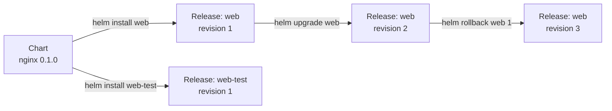
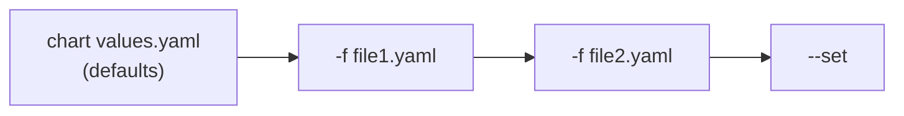
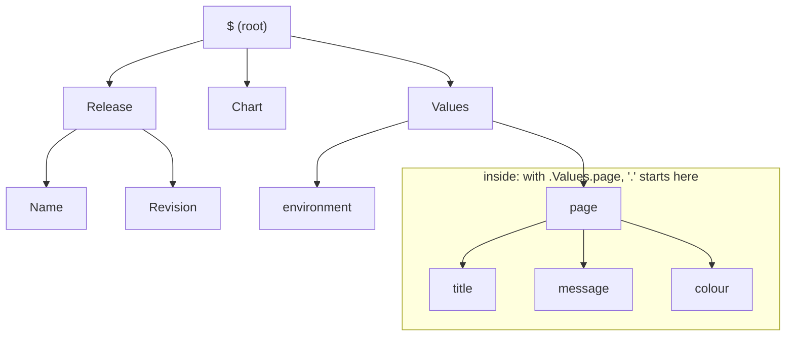

# Helm Basics

Helm packages your manifests as templates and tracks every install so you can upgrade and roll back.

Covers: why Helm exists, charts, releases and revisions, installing someone else's chart, overriding values, writing your own chart (hello-world, then the nginx Deployment from the Kustomize lessons), template functions, pipelines, conditionals, `with`, `range`, named templates, and the upgrade/rollback lifecycle.

Worked examples: `charts/1_hello-world/` (one ConfigMap, nothing else) and `charts/2_nginx/` (the `web` Deployment from Kustomize Basics section 1, as a chart). Every command below is run from the `Helm/` folder of this repo.

The "Try it" parts are what we run in the session; section 11 has exercises for afterwards.

---

## Key terms

| Term | Definition |
|------|------------|
| **Chart** | A directory (or `.tgz`) of templates plus default values that describes everything an app needs. The package. |
| **Template** | A Kubernetes manifest with `{{ }}` placeholders in it. Not valid YAML until Helm renders it. |
| **Values** | The data that fills the placeholders. Defaults live in the chart's `values.yaml`; you override them with `--set` or `-f`. |
| **Release** | One installed copy of a chart, with a name you choose. The same chart can be installed many times as different releases. |
| **Revision** | A numbered snapshot of a release. Every install, upgrade and rollback adds one. |
| **Repository** | A place charts are published: an HTTP chart repo or an OCI registry. Artifact Hub (artifacthub.io) indexes the public ones. |
| **Render** | Fill in the templates with values and produce plain YAML. `helm template` renders without touching the cluster. |
| **Named template** | A reusable snippet (usually in `_helpers.tpl`) pulled into other templates with `include`. |

---

## 1. Why Helm

Kustomize Basics opened with three copies of the same NGINX Deployment, one each for dev, stage and prod, and six values that actually differed between them. Kustomize's answer was one base plus a short overlay per environment.

That solves duplication. It doesn't solve the rest of running an app:

- **Kubernetes doesn't know what an "app" is.** It knows a Deployment, a Service, a ConfigMap. Nothing in the cluster says those three belong together, which version of the app they are, or what they looked like before last Tuesday's change.
- **Upgrading is a pile of `kubectl apply` commands.** Remove a manifest from the folder and the old object just stays in the cluster.
- **Going back is manual.** If the upgrade breaks, you need to know what was there before and re-apply it by hand.
- **Third-party software ships as hundreds of files.** cert-manager, ingress controllers, monitoring stacks. Nobody wants to copy those YAML files around and edit them.

Helm treats the whole set of objects as one thing. Think of a support case where a customer says "monitoring broke after we upgraded it." Without Helm you're asking which of the 40 manifests changed, who applied them, and what they looked like before. With Helm you run `helm history`, see that revision 5 went out yesterday, diff it against revision 4, and roll back with one command while you figure out the root cause.

```bash
helm install    # put it in
helm upgrade    # change it
helm rollback   # undo the change
helm uninstall  # take it all out
```

One command per lifecycle step, for the whole app.

---

## 2. Helm vs Kustomize

The same comparison from Kustomize Basics section 2, seen from the other side.

**Kustomize** keeps finished YAML and describes changes to it. **Helm** keeps YAML with blanks in it and fills them in:

<table>
<tr>
<th>Kustomize: <code>overlays/prod/kustomization.yaml</code></th>
<th>Helm: <code>charts/2_nginx/values-prod.yaml</code></th>
</tr>
<tr>
<td valign="top">

```yaml
apiVersion: kustomize.config.k8s.io/v1beta1
kind: Kustomization

resources:
  - ../../base

labels:
  - pairs:
      environment: prod
      cost-centre: platform

replicas:
  - name: web
    count: 10

images:
  - name: nginx
    newTag: "1.27.2"

patches:
  - patch: |-
      apiVersion: apps/v1
      kind: Deployment
      metadata:
        name: web
      spec:
        template:
          spec:
            containers:
              - name: nginx
                resources:
                  requests:
                    cpu: 500m
                    memory: 512Mi
```

</td>
<td valign="top">

```yaml
environment: prod
replicaCount: 10

image:
  tag: "1.27.2"

resources:
  requests:
    cpu: 500m
    memory: 512Mi

extraLabels:
  cost-centre: platform
```

</td>
</tr>
</table>

Same six differences, same result. The Helm file is shorter because the chart author already decided where each value goes. The Kustomize file is longer because it has to say *where* to make each change, but it can change anything, including fields the chart author never thought of.

| | Kustomize | Helm |
|---|---|---|
| Approach | Patch finished YAML | Render templates with variables |
| Files are valid YAML | Yes, always | No, not until rendered |
| Can change any field | Yes | Only fields the chart exposes as values |
| Logic (if/loops/functions) | No | Yes |
| Packaging and distribution | No | Yes, charts are versioned packages |
| Release tracking and rollback | No | Yes |
| Needs installing | No, built into `kubectl` | Yes |

They aren't mutually exclusive. The usual split is Helm for third-party software (cert-manager, ingress controllers, monitoring) and either tool for in-house apps. GitOps tools like Argo CD and Flux can deploy both.

---

## 3. Charts, releases and revisions




- **The chart** is the package. It doesn't change when you install it.
- **A release** is one install of it. `web` and `web-test` above are the same chart installed twice, tracked separately. This is how you reproduce a customer issue safely: install the same chart and version they run as a separate release next to your own, with their values, and neither one touches the other.
- **A revision** is a snapshot of one release. Every change adds a revision, including a rollback. Rolling back from revision 2 to revision 1 creates revision **3**, a copy of 1. History only moves forwards.

### Where Helm keeps track

There's nothing running in the cluster for Helm. The CLI does all the work using your kubeconfig, the same as `kubectl`. (Helm 2 had a server-side component called Tiller. It was removed in Helm 3, and older blog posts still mention it.)

The release history is stored in the cluster as **Secrets**, one per revision, in the release's namespace:

```bash
kubectl get secrets -n lesson -l owner=helm
```

Good output, after the hello-world release in section 7 has been upgraded once:

```
NAME                          TYPE                 DATA   AGE
sh.helm.release.v1.hello.v1   helm.sh/release.v1   1      5m
sh.helm.release.v1.hello.v2   helm.sh/release.v1   1      1m
```

Because the history lives in the cluster, anyone with access to the namespace sees the same releases, and nothing is lost if your laptop is. It also means deleting those Secrets makes Helm forget the release while the workloads keep running. Don't.

---

## 4. Installing it and checking the version

The current major version is **Helm 4** (released November 2025). Helm 3 stopped getting bug fixes in September 2026 but still gets security fixes until 10 February 2027, so you'll see both. Everything in this lesson works the same on either.

```bash
helm version
```

What it does: prints the client version.
Good output: `version.BuildInfo{Version:"v4.x.x", ...}` or `v3.x.x`.
Bad output: `command not found`. Install it:

```bash
# macOS
brew install helm

# Linux: the official script. Download it, read it, then run it.
curl -fsSL -o get_helm.sh https://raw.githubusercontent.com/helm/helm/main/scripts/get-helm-4
chmod 700 get_helm.sh
./get_helm.sh
```

> Older runbooks use `get-helm-3`. It still works but installs Helm 3.

Helm talks to whichever cluster your current kubeconfig context points at. Check before every install:

```bash
kubectl config current-context
```

For the session we'll use a namespace of our own:

```bash
kubectl create namespace lesson
```

### What changed in Helm 4

Charts written for Helm 3 work on Helm 4, and Helm 4 can upgrade releases created by Helm 3. The changes you're most likely to notice in older notes and runbooks:

| Helm 3 | Helm 4 |
|---|---|
| `--atomic` | `--rollback-on-failure` (old name works, prints a warning) |
| `--force` | `--force-replace` (old name works, prints a warning) |
| Client-side apply | Server-side apply for new installs. Existing releases keep whichever they used before |
| `--post-renderer ./script.sh` | Post-renderers must be plugins |
| `helm registry login https://host/path` | Domain only: `helm registry login host` |

---

## 5. Using someone else's chart

Most of the time you'll install charts other people wrote. The flow is: find it, add its repository, look at its values, install it.

### Finding a chart

```bash
helm search hub podinfo
```

What it does: searches Artifact Hub (artifacthub.io), the public index of Helm charts. Nothing is added or downloaded.
Good output: a table of chart URLs, versions and descriptions.

`podinfo` is a small demo web app built for exactly this kind of lesson: one Deployment, one Service, tiny image.

### Adding the repository

```bash
helm repo add podinfo https://stefanprodan.github.io/podinfo
helm repo list
helm search repo podinfo
```

What it does: saves the repo under the short name `podinfo`, downloads its index, then searches the repos you've added (not Artifact Hub).
Good output: `"podinfo" has been added to your repositories`, then a `podinfo/podinfo` row with a chart version and app version.

The index is a local cache. When a new chart version comes out, you won't see it until you refresh:

```bash
helm repo update
```

### Looking before installing

```bash
helm show chart podinfo/podinfo
helm show values podinfo/podinfo
```

What it does: prints the chart's `Chart.yaml` and its default `values.yaml`. This is the chart's real documentation: every knob you can turn is in `show values`.

Render it without installing, to see exactly what would hit the cluster:

```bash
helm template demo podinfo/podinfo | less
```

### Installing it

```bash
helm install demo podinfo/podinfo -n lesson
```

What it does: renders the chart with its defaults and creates the objects as a release called `demo`.
Good output: `STATUS: deployed`, `REVISION: 1`, followed by the chart's **NOTES**, usually instructions for reaching the app.
Bad output: `cannot re-use a name that is still in use` means a release called `demo` already exists in that namespace. Pick another name or use `helm upgrade`.

```bash
helm list -n lesson
```

`helm list` shows **releases**: name, namespace, revision, status, chart version and app version. Use `-A` for every namespace.

### Installing straight from an OCI registry

Many charts are now published to container registries instead of (or as well as) HTTP repos. No `repo add` needed:

```bash
helm install demo-oci oci://ghcr.io/stefanprodan/charts/podinfo -n lesson
```

A growing number of vendors distribute charts this way, and it's the direction most projects are heading.

### Removing it

> Lab or test environment only. `helm uninstall` deletes every object the release created.

```bash
helm uninstall demo -n lesson
helm uninstall demo-oci -n lesson
```

What it does: deletes all objects belonging to the release, then its history.
Good output: `release "demo" uninstalled`.

Same scope argument as `kubectl delete -k` in the Kustomize lessons: the release defines exactly what gets removed, so nothing else in the namespace is touched.

---

## 6. Overriding values

A chart's `values.yaml` holds the defaults. You change the app by overriding values, never by editing the templates.

### `--set` for one or two values

```bash
helm install demo podinfo/podinfo -n lesson --set replicaCount=2
```

Nested keys use dots: `--set image.tag=6.5.0`. Lists use braces: `--set 'extraArgs={--level=debug,--random-delay}'`. It gets unreadable quickly, and the values only exist in your shell history.

### `-f` for anything more

Write the overrides to a file and pass it with `-f` (long form `--values`):

```yaml
# my-values.yaml
replicaCount: 2
ui:
  message: Hello from the team
```

```bash
helm install demo podinfo/podinfo -n lesson -f my-values.yaml
```

The file only needs the keys you're changing. Everything else keeps the chart's default. That file can go in Git, which `--set` can't.

A quick way to start one: dump the defaults and delete what you don't need.

```bash
helm show values podinfo/podinfo > my-values.yaml
```

### Which one wins

Later beats earlier:



`--set` always beats `-f`. With several `-f` files, the last one wins. That's how `values-prod.yaml` in section 8 can sit on top of the defaults.

### What a release is actually using

```bash
helm get values demo -n lesson          # only what you overrode
helm get values demo -n lesson --all    # overrides merged with defaults
helm get manifest demo -n lesson        # the rendered YAML that was applied
```

The first command is the one to ask for on a support case. It's the difference between this install and the chart's defaults, in a few lines.

### Downloading the chart itself

```bash
helm pull podinfo/podinfo --untar
ls podinfo/
```

What it does: downloads the chart and extracts it into `./podinfo/` so you can read the templates. Without `--untar` you get the `.tgz`. Pulling changes nothing; it's a copy for reading or for installing locally with `helm install demo ./podinfo`.

---

## 7. Your first chart: hello-world

Now the other side: writing one. `helm create` builds a full skeleton (Deployment, Service, Ingress, HPA, ServiceAccount, tests), which is a lot to take in at once. The example here is the smallest chart that does something.

```
charts/1_hello-world/
├── Chart.yaml
├── values.yaml
└── templates/
    ├── configmap.yaml
    └── NOTES.txt
```

### Chart.yaml

`charts/1_hello-world/Chart.yaml`:

```yaml
apiVersion: v2
name: hello-world
description: The smallest useful chart. One ConfigMap, filled in from values and built-in objects.
type: application
version: 0.1.0
appVersion: "1.0.0"
maintainers:
  - name: James Nguyen
```

Every chart has exactly one, named exactly `Chart.yaml` (capital C, singular).

- `apiVersion: v2` is the chart format for Helm 3 and 4. `v1` is Helm 2. (Helm 4 has an experimental `v3`; ignore it for now.)
- `version` is the **chart's** version. Bump it every time anything in the chart changes.
- `appVersion` is the version of the **app** the chart deploys. They move independently: a chart can go from 0.1.0 to 0.2.0 to fix a label while still deploying nginx 1.27.2. Mixing these two up is the most common Chart.yaml mistake.

### values.yaml

`charts/1_hello-world/values.yaml`:

```yaml
# Defaults. Override with --set or -f at install/upgrade time.
greeting: Hello
audience: world
```

This is the chart's list of settings and their default values. The templates never hard-code anything that might change between installs; they read it from here instead.

- **You make up the keys.** Helm doesn't define `greeting` or `audience`. The chart author picks names, and the templates refer to them as `.Values.greeting` and `.Values.audience`. Nested keys work too: `image: {tag: "1.27"}` becomes `.Values.image.tag`.
- **It's the chart's interface.** Whoever installs the chart changes these values with `--set` or `-f` (section 6), not by editing templates. If something isn't in `values.yaml`, users can't change it without forking the chart. This is the file `helm show values` printed for podinfo.
- **The name is fixed.** It must be called `values.yaml` and sit next to `Chart.yaml`. Files like `values-prod.yaml` in section 8 are just override files you pass with `-f`; Helm doesn't load them on its own.
- **It's plain YAML.** No `{{ }}` in here. Templating only happens in `templates/`.

### The template, and what it renders to

A template is a normal Kubernetes manifest with gaps in it. The gaps are marked with `{{ }}`, and Helm fills them in at install time to produce the plain YAML that gets sent to the cluster.

- **One file, usually one resource.** Each file in `templates/` typically holds one object (a ConfigMap, a Deployment, a Service). Helm renders every file in the folder and applies them all together as one release.
- **The file name is up to you.** `configmap.yaml` is a convention, not a rule. Helm reads everything in `templates/` except files starting with `_` (helpers, section 8) and `NOTES.txt`, which is printed rather than applied (below).
- **It can't be applied until it's rendered.** `kubectl apply` on a template fails or creates garbage, because the `{{ }}` are still in it. Use `helm template` to see the result, which is what the right-hand column shows.
- **The logic lives here, the settings live in `values.yaml`.** Templates decide *where* a value goes; `values.yaml` decides *what* it is.

<table>
<tr>
<th><code>templates/configmap.yaml</code></th>
<th><code>helm template hello charts/1_hello-world -n lesson</code></th>
</tr>
<tr>
<td valign="top">

```yaml
apiVersion: v1
kind: ConfigMap
metadata:
  name: {{ .Release.Name }}-hello
data:
  message: "{{ .Values.greeting }}, {{ .Values.audience }}!"
  release: "{{ .Release.Name }}"
  namespace: "{{ .Release.Namespace }}"
  revision: "{{ .Release.Revision }}"
  chart: "{{ .Chart.Name }}-{{ .Chart.Version }}"
```

</td>
<td valign="top">

```yaml
---
# Source: hello-world/templates/configmap.yaml
apiVersion: v1
kind: ConfigMap
metadata:
  name: hello-hello
data:
  message: "Hello, world!"
  release: "hello"
  namespace: "lesson"
  revision: "1"
  chart: "hello-world-0.1.0"
```

</td>
</tr>
</table>

(Comments trimmed from the file in the repo.)

Everything in `{{ }}` is replaced. Everything else passes through untouched. The values come from three places, called **built-in objects**:

| Object | Comes from | Examples |
|---|---|---|
| `.Values` | `values.yaml` plus your `--set` / `-f` overrides | `.Values.greeting` |
| `.Release` | The install command and the release history | `.Release.Name`, `.Release.Namespace`, `.Release.Revision`, `.Release.IsInstall`, `.Release.IsUpgrade` |
| `.Chart` | `Chart.yaml` | `.Chart.Name`, `.Chart.Version`, `.Chart.AppVersion` |

Two rules that catch everyone:

- **It's case-sensitive.** Built-in objects and their fields start with a capital letter: `.Values`, `.Release.Name`. `.values.greeting` fails with `nil pointer evaluating interface {}.greeting`.
- **Every value has to exist.** `{{ .Values.greting }}` (typo) doesn't error. It renders as empty and you get `message: ", world!"`. Always read the rendered output.

Why the quotes around `"{{ .Release.Revision }}"`? ConfigMap data must be strings, and `1` on its own is a number. Section 8 shows the cleaner way, the `quote` function.

### NOTES.txt

`templates/NOTES.txt` is a template too, but it's printed to the terminal after install instead of being sent to the cluster. Use it to tell the person installing what to do next.

### Checking it before installing

Three levels, from fastest to most thorough:

```bash
helm lint charts/1_hello-world
```

What it does: checks the chart's structure and that the templates render.
Good output: `1 chart(s) linted, 0 chart(s) failed`. An `[INFO] icon is recommended` line is fine.

```bash
helm template hello charts/1_hello-world -n lesson
```

What it does: renders the templates and prints the YAML. No cluster needed, nothing created. The Helm equivalent of `kustomize build`.

```bash
helm install hello charts/1_hello-world -n lesson --dry-run=server
```

What it does: renders, then sends the result to the API server for validation without creating anything. Catches things `template` can't, like a field that doesn't exist on that Kubernetes version.

### Try it

```bash
helm install hello charts/1_hello-world -n lesson
```

Good output: `STATUS: deployed`, `REVISION: 1`, then the NOTES with a command to read the message.

```bash
kubectl get configmap hello-hello -n lesson -o jsonpath='{.data.message}{"\n"}'
```

Good output: `Hello, world!`

Install it a second time, under another name and with an override:

```bash
helm install hello-team charts/1_hello-world -n lesson --set audience=team
helm list -n lesson
kubectl get configmap hello-team-hello -n lesson -o jsonpath='{.data.message}{"\n"}'
```

Good output: two releases in `helm list`, and `Hello, team!`. Same chart, two releases, tracked separately. Keep `hello` around; section 9 upgrades it.

---

## 8. The nginx chart

`charts/2_nginx/` is the `web` Deployment from Kustomize Basics section 1, with a Service and a ConfigMap holding the web page. It uses every templating feature in this lesson.

```
charts/2_nginx/
├── Chart.yaml
├── values.yaml           # defaults (dev)
├── values-stage.yaml     # only what stage changes
├── values-prod.yaml      # only what prod changes
└── templates/
    ├── _helpers.tpl      # named templates
    ├── configmap.yaml    # index.html
    ├── deployment.yaml
    ├── service.yaml
    └── NOTES.txt
```

### The three environments

The Kustomize lessons ended up with a base plus three overlays. Here it's one set of templates, a defaults file, and two short override files:

<table>
<tr>
<th><code>values.yaml</code> (dev, abridged)</th>
<th><code>values-stage.yaml</code></th>
<th><code>values-prod.yaml</code></th>
</tr>
<tr>
<td valign="top">

```yaml
environment: dev
replicaCount: 1

image:
  repository: nginx
  tag: "1.27"

resources:
  requests:
    cpu: 100m
    memory: 128Mi

extraLabels: {}
```

</td>
<td valign="top">

```yaml
environment: stage
replicaCount: 2

image:
  tag: "1.27.2"
```

</td>
<td valign="top">

```yaml
environment: prod
replicaCount: 10

image:
  tag: "1.27.2"

resources:
  requests:
    cpu: 500m
    memory: 512Mi

extraLabels:
  cost-centre: platform
```

</td>
</tr>
</table>

The same six rows from the Kustomize Basics table, each written once:

| Field | dev | stage | prod |
|---|---|---|---|
| `environment` label | `dev` | `stage` | `prod` |
| `cost-centre` label | absent | absent | `platform` |
| `replicaCount` | `1` | `2` | `10` |
| `image.tag` | `1.27` | `1.27.2` | `1.27.2` |
| `resources.requests.cpu` | `100m` | `100m` | `500m` |
| `resources.requests.memory` | `128Mi` | `128Mi` | `512Mi` |

Values files merge, they don't replace. `values-prod.yaml` sets `image.tag` but not `image.repository`, and the repository still comes from `values.yaml`.

```bash
helm template web charts/2_nginx -f charts/2_nginx/values-prod.yaml -s templates/deployment.yaml
```

What it does: renders only the Deployment (`-s`, `--show-only`) with prod's overrides on top of the defaults.
Good output: `replicas: 10`, `image: "nginx:1.27.2"`, `cpu: 500m`, and both `environment: prod` and `cost-centre: "platform"` labels.

The rest of this section walks through the templates that make that work.

### Functions

A function transforms a value: makes it upper case, adds quotes, supplies a default. Same idea as `"helm".upper()` in Python, but the function goes first and arguments are separated by spaces:

```yaml
{{ upper .Values.environment }}        # dev  -> DEV
{{ quote .Values.environment }}        # dev  -> "dev"
{{ default "white" .Values.colour }}   # empty -> white
{{ replace "-" "_" .Release.Name }}   # my-web -> my_web
```

**Reading a function call.** Everything inside `{{ }}` is read left to right as *function name, then its arguments*, separated by spaces. No commas, no brackets around the arguments:

```
{{ default   "white"     .Values.colour }}
   ───┬───   ───┬───     ──────┬───────
   function   arg 1         arg 2
              (fallback)    (the value to check)
```

- **Arguments can be literals or values.** `"white"` is a fixed string; `.Values.colour` is looked up from values. Strings need double quotes; numbers and `true`/`false` don't.
- **Argument order is fixed by the function, not by you.** `default` always takes the fallback first. `replace` takes *old*, *new*, then the string to work on. When in doubt, check the function list.
- **Nesting needs parentheses.** To use one function's result as another's argument, wrap the inner call: `{{ upper (default "dev" .Values.environment) }}`. Without the brackets, `upper` would be handed three arguments and fail with `wrong number of args`.

Helm uses Go templates plus the **Sprig** function library, so there are well over a hundred. The full list: https://helm.sh/docs/chart_template_guide/function_list/

The ones that turn up in nearly every chart:

| Function | What it does |
|---|---|
| `quote` | Wraps the value in double quotes. Use it for anything that must stay a string (`"1.27"`, `"true"`, `"0755"`). |
| `default` | Uses a fallback when the value is empty or missing. |
| `upper` / `lower` | Changes case. |
| `toYaml` | Turns a whole block of values (a map or list) into YAML. |
| `nindent N` | Adds a newline, then indents every line by N spaces. Needed whenever you insert a multi-line block. |
| `required "msg"` | Fails the render with your message if the value is missing. |

> **`default` gotcha:** "empty" includes `0` and `false`, not just missing. `{{ .Values.replicaCount | default 3 }}` gives `3` when someone deliberately sets `replicaCount: 0`. Don't use `default` on values where `0` or `false` is a legitimate choice.

### Pipelines

`|` passes the result of one thing into the next function, the same as a shell pipe. These two are identical:

```yaml
{{ quote (upper .Values.environment) }}    # inside out:    dev -> DEV -> "DEV"
{{ .Values.environment | upper | quote }}  # left to right: dev -> DEV -> "DEV"
#  └───────┬─────────┘   └─┬─┘   └─┬─┘
#         dev             DEV    "DEV"
```

**The one rule:** the value on the left of `|` is passed in as the **last** argument of the function on the right. So:

| Pipeline | Is the same as |
|---|---|
| `.Values.environment \| upper` | `upper .Values.environment` |
| `.Values.colour \| default "white"` | `default "white" .Values.colour` |
| `.Release.Name \| replace "-" "_"` | `replace "-" "_" .Release.Name` |

That's why functions like `default` and `replace` put "the thing being worked on" last: it makes them pipe-friendly.

**Step by step.** Each stage hands its result to the next. With a release called `my-web`:

```yaml
{{ .Release.Name | replace "-" "_" | upper | quote }}
```

| Stage | Result |
|---|---|
| `.Release.Name` | `my-web` |
| `\| replace "-" "_"` | `my_web` |
| `\| upper` | `MY_WEB` |
| `\| quote` | `"MY_WEB"` |

When a pipeline gives the wrong result, take stages off the end until you find the one that misbehaves.

The pipeline version reads left to right, so it's the one you'll see in most charts. From `templates/deployment.yaml`:

```yaml
image: "{{ .Values.image.repository }}:{{ .Values.image.tag | default .Chart.AppVersion }}"
```

If `image.tag` is set, use it. If it's empty, fall back to `appVersion` from `Chart.yaml`. Try it:

```bash
helm template web charts/2_nginx --set image.tag="" -s templates/deployment.yaml | grep image:
```

Good output: `image: "nginx:1.27.2"`, the chart's `appVersion`.

### Conditionals

A conditional is an `if` block in a template. Helm checks the condition while rendering: if it's true, the lines inside are kept; if it's false, they're left out of the output.

- **It decides what's in the YAML, not what happens in the cluster.** The check runs once, inside `helm template` or `helm install`. Kubernetes never sees the `if`, only the result.
- **A false branch leaves nothing behind.** The field or object isn't set to empty or `null`; it's simply not there. That's what lets you drop a field the API server would reject.
- **The condition almost always reads from values.** That makes it a switch the person installing can flip with `--set` or `-f`, without touching the template. `ingress.enabled: true` is the classic example.
- **It's how one chart covers several setups.** Instead of a separate file for each environment or Service type, one template carries the variations and values pick between them.

Some objects or fields should only exist sometimes. A `nodePort` only makes sense on a `NodePort` Service; on a `ClusterIP` Service the API server rejects it. From `templates/service.yaml`:

<table>
<tr>
<th>Template</th>
<th><code>--set service.type=NodePort</code></th>
<th>Default (<code>ClusterIP</code>)</th>
</tr>
<tr>
<td valign="top">

```yaml
spec:
  type: {{ .Values.service.type }}
  ports:
    - port: {{ .Values.service.port }}
      targetPort: 80
      {{- if eq .Values.service.type "NodePort" }}
      nodePort: {{ .Values.service.nodePort }}
      {{- end }}
```

</td>
<td valign="top">

```yaml
spec:
  type: NodePort
  ports:
    - port: 80
      targetPort: 80
      nodePort: 30080
```

</td>
<td valign="top">

```yaml
spec:
  type: ClusterIP
  ports:
    - port: 80
      targetPort: 80
```

</td>
</tr>
</table>

(Selector lines trimmed.)

```bash
helm template web charts/2_nginx --set service.type=NodePort -s templates/service.yaml
```

The pieces:

- `{{- if ... }}` ... `{{- else if ... }}` ... `{{- else }}` ... `{{- end }}`. Every `if` needs an `end`.
- Comparisons are functions, so the operator comes first: `eq a b`, `ne`, `lt`, `le`, `gt`, `ge`. Combine with `and`, `or`, `not`.
- A bare value is true unless it's empty: `false`, `0`, `""`, an empty list or map, or missing. `{{- if .Values.extraLabels }}` means "if there are any extra labels".

Reading `eq .Values.service.type "NodePort"` out loud: "is `service.type` equal to `NodePort`?"

**The dash.** `{{-` removes the whitespace and newline *before* the tag, `-}}` removes it *after*. Without the dashes, every `if` and `end` line leaves a blank line in the output. Rule of thumb: put `{{-` on any tag that sits on a line by itself.

The most common use is switching a whole object on or off. Wrap the entire file:

```yaml
{{- if .Values.ingress.enabled }}
apiVersion: networking.k8s.io/v1
kind: Ingress
...
{{- end }}
```

The `helm create` skeleton does this for its Ingress, HPA and ServiceAccount.

### `with`: changing the scope

`with` is a block that says "for the next few lines, I'm working with this one part of the values." Inside it, you can write short names like `.title` instead of the full path `.Values.page.title`.

- **It's a shortcut, not a feature of the output.** The rendered YAML is identical with or without `with`. Only the template gets shorter and easier to read.
- **Use it for a group of related settings.** It pays off when several lines read keys under the same parent, like `page.title`, `page.message` and `page.colour`. For a single value, just write the full path.
- **It only lasts until `{{- end }}`.** After the block, everything goes back to normal and `.Values...` works again.
- **The catch is that `.` changes meaning inside it.** Anything outside that branch, like `.Release.Name`, needs `$` in front.

Every template starts with `.` pointing at the **root**, which is why everything starts `.Values...` or `.Release...`. Deep values get long: `.Values.page.title`, `.Values.page.message`, `.Values.page.colour`.

`with` moves `.` down to one branch for the length of the block:



From `templates/configmap.yaml`:

<table>
<tr>
<th>Without <code>with</code></th>
<th>With <code>with</code> (what the chart does)</th>
</tr>
<tr>
<td valign="top">

```yaml
<h1>{{ .Values.page.title }}</h1>
<p>{{ .Values.page.message }}</p>
<p>Release {{ .Release.Name }}</p>
```

</td>
<td valign="top">

```yaml
{{- with .Values.page }}
<h1>{{ .title }}</h1>
<p>{{ .message }}</p>
<p>Release {{ $.Release.Name }}</p>
{{- end }}
```

</td>
</tr>
</table>

Inside the block, `.` **is** `.Values.page`. That's convenient, and it's also the trap: `.Release` now means `.Values.page.Release`, which doesn't exist. To reach the root from inside a `with` (or a `range`), use `$`. `$` always points at the root, wherever you are.

**Think of `.` as "you are here".** Line by line through the chart's `with` block; It's like `cd` in a shell: `with` is `cd .Values/page`, relative paths start from there, and `$` is an absolute path from `/`.


### `range`: loops

`range` runs the block once per item in a list or map. Inside the loop, `.` is the current item.

It's `with` on repeat: each pass moves `.` to the next item, runs the block, and when the items run out `.` goes back to where it was. Same as a shell loop:

Because `.` is the item, anything from the root (`.Release.Name`, `.Values.environment`) needs `$` inside the loop, exactly as in `with`.

Ask for the key and value by name. This is how prod gets its `cost-centre` label, from `templates/deployment.yaml`:

<table>
<tr>
<th>Template</th>
<th>Rendered with <code>values-prod.yaml</code></th>
</tr>
<tr>
<td valign="top">

```yaml
metadata:
  labels:
    {{- include "nginx.labels" . | nindent 4 }}
    {{- range $key, $value := .Values.extraLabels }}
    {{ $key }}: {{ $value | quote }}
    {{- end }}
```

</td>
<td valign="top">

```yaml
metadata:
  labels:
    app.kubernetes.io/name: nginx
    app.kubernetes.io/instance: web
    app.kubernetes.io/version: "1.27.2"
    app.kubernetes.io/managed-by: Helm
    helm.sh/chart: nginx-0.1.0
    environment: prod
    cost-centre: "platform"
```

</td>
</tr>
</table>

Maps are always looped in alphabetical order of key, so the output is stable between runs.

`range $key, $value := ...` reads as "for each entry, call the key `$key` and the value `$value`". The names are yours to pick; `$k, $v` works the same.

**Empty maps.** Like `with`, `range` takes an `else`, which runs when there's nothing to loop over:

```yaml
{{- range $key, $value := .Values.extraLabels }}
{{ $key }}: {{ $value | quote }}
{{- else }}
# no extra labels
{{- end }}
```

**`with`, `range` and `if` at a glance:**

| | Runs the block | `.` inside the block | Has `else` |
|---|---|---|---|
| `if X` | once, if X is non-empty | unchanged | yes |
| `with X` | once, if X is non-empty | X | yes |
| `range X` | once per item in X | the current item | yes, when X is empty |

### Named templates

The Deployment, Service and ConfigMap all need the same labels, and the Deployment's selector and the Service's selector must match exactly. Copying the label block into every file is the same duplication problem from section 1, and the Kustomize lesson already showed what happens when a selector and the pod labels drift: a Service with no endpoints.

Write it once in `templates/_helpers.tpl`. Files starting with `_` are never rendered as manifests; they only hold definitions:

```yaml
{{/* Labels that identify the pods. Used in selectors, so never change them after install. */}}
{{- define "nginx.selectorLabels" -}}
app.kubernetes.io/name: {{ .Chart.Name }}
app.kubernetes.io/instance: {{ .Release.Name }}
{{- end }}

{{/* Every label: the selector labels plus informational ones */}}
{{- define "nginx.labels" -}}
{{ include "nginx.selectorLabels" . }}
app.kubernetes.io/version: {{ .Chart.AppVersion | quote }}
app.kubernetes.io/managed-by: {{ .Release.Service }}
helm.sh/chart: {{ .Chart.Name }}-{{ .Chart.Version }}
environment: {{ .Values.environment }}
{{- end }}
```

Then pull them in wherever they're needed:

```yaml
# templates/service.yaml
metadata:
  labels:
    {{- include "nginx.labels" . | nindent 4 }}
spec:
  selector:
    {{- include "nginx.selectorLabels" . | nindent 4 }}
```

Three details in that one line:

- **`include`, not `template`.** Both insert a named template, but `template` is an action, not a function, so its output can't go through a pipeline. `{{ template "nginx.labels" . | nindent 4 }}` fails with `wrong type for value; expected string; got common.Values` (`chartutil.Values` on Helm 3). Use `include` every time.
- **`nindent 4`.** The snippet has no indentation of its own. `nindent` adds a newline and indents each line to match where it's going: 4 under `metadata.labels`, 6 under `spec.selector.matchLabels`, 8 under the pod template's labels.
- **The `.` at the end.** That's the scope being passed in. Leave it off and the snippet can't see `.Chart` or `.Release`. Inside a `with` or `range`, pass `$` instead.

What a missing `nindent` looks like. It **doesn't error**, and `helm lint` passes:

```yaml
metadata:
  name: web-nginx
  labels:
    app.kubernetes.io/name: nginx
app.kubernetes.io/instance: web
app.kubernetes.io/version: "1.27.2"
```

Only the first line lands under `labels:`. The rest end up at the top level of the object. That's why the habit is: render it and read it.

### Try it

Render all three environments and compare:

```bash
helm template web charts/2_nginx > dev.yaml
helm template web charts/2_nginx -f charts/2_nginx/values-stage.yaml > stage.yaml
helm template web charts/2_nginx -f charts/2_nginx/values-prod.yaml > prod.yaml
diff dev.yaml prod.yaml
```

Good output: the differences from the table above, the `DEV`/`PROD` line on the web page, and a different `checksum/page` annotation (more on that in section 9). Nothing else.

Install dev and look at it:

```bash
helm install web charts/2_nginx -n lesson
kubectl get pods -n lesson -l app.kubernetes.io/instance=web
kubectl port-forward -n lesson svc/web-nginx 8080:80
```

Good output: 1 pod `Running`. Browse to http://localhost:8080 and you get a blue page reading "Hello from Helm", with `Release web, revision 1, environment DEV`. `Ctrl+C` stops the port-forward.

---

## 9. Upgrade, history, rollback

This is the part Kustomize doesn't do.

### Upgrade

```bash
helm upgrade hello charts/1_hello-world -n lesson --set audience=team
kubectl get configmap hello-hello -n lesson -o jsonpath='{.data.message} (rev {.data.revision}){"\n"}'
```

What it does: renders the chart again with the new values, works out what changed, and applies only that. A new revision is recorded.
Good output: `REVISION: 2`, then `Hello, team! (rev 2)`.

> If you pass **any** `--set` or `-f` to `helm upgrade`, it starts from the **chart defaults** plus only what you passed this time, not from what's currently installed. `helm upgrade hello charts/1_hello-world -n lesson --set greeting=Hi` gives `Hi, world!`: the earlier `audience=team` is gone. (An upgrade with no values flags at all quietly carries the previous values forward, which makes this easy to miss.) Pass the same `-f` files every time (this is why they belong in Git), or use `--reuse-values` to carry the previous overrides forward.


### History

```bash
helm history hello -n lesson
```

Good output:

```
REVISION  UPDATED   STATUS      CHART              APP VERSION  DESCRIPTION
1         ...       superseded  hello-world-0.1.0  1.0.0        Install complete
2         ...       deployed    hello-world-0.1.0  1.0.0        Upgrade complete
```

Only one revision is `deployed` at a time. Older ones are `superseded`. A `failed` row means that upgrade didn't complete; the description column says why.

### Rollback

```bash
helm rollback hello 1 -n lesson
helm history hello -n lesson
kubectl get configmap hello-hello -n lesson -o jsonpath='{.data.message} (rev {.data.revision}){"\n"}'
```

What it does: re-applies revision 1's rendered manifests. Leave off the number to go back one.
Good output: `Rollback was a success!`, a **third** row in history (`Rollback to 1`), and `Hello, world! (rev 1)`.

The ConfigMap says `rev 1` because the rollback re-applied revision 1's manifests exactly as they were rendered, including `.Release.Revision` at the time. Helm's own history says 3.

Two limits worth saying out loud:

- **Rollback restores manifests, not data.** If an upgrade ran a database migration or wrote to a PersistentVolume, rolling back the Deployment doesn't undo that. Back up data separately, for example with a chart hook (see section 12).
- **Rollback is a new revision, not a time machine.** Rev 3 above is a copy of rev 1. You can roll back the rollback with `helm rollback hello 2`.

### Pods restarting when only config changed

Change the page text on the nginx release:

```bash
helm upgrade web charts/2_nginx -n lesson --set page.title="Upgraded by Helm"
kubectl get pods -n lesson -l app.kubernetes.io/instance=web
```

Good output: a new pod, a few seconds old. Refresh the port-forward and the title has changed.

On its own, changing a ConfigMap doesn't restart the pods using it. The Deployment template carries this annotation:

```yaml
annotations:
  checksum/page: {{ include (print $.Template.BasePath "/configmap.yaml") . | sha256sum }}
```

It renders the ConfigMap template, hashes it, and puts the hash on the pod template. When the page changes, the hash changes, the pod template changes, and Kubernetes rolls the pods. Same idea as the name-hash Kustomize adds to generated ConfigMaps. Because this page shows the revision number, the hash changes on every upgrade, so every upgrade rolls the pods.

### Clean up

> Lab or test environment only.

```bash
helm uninstall hello hello-team web -n lesson
kubectl delete namespace lesson
```

---

## Recap

- A **chart** is the package, a **release** is one install of it, a **revision** is one snapshot of a release. Rollback adds a revision.
- Change an app through **values**: `-f` files in Git, `--set` for one-offs. Later beats earlier, `--set` beats everything.
- Templates are not YAML until rendered. **`helm template` and read the output** before every install. A typo or a missing `nindent` renders silently.
- `.` is the current scope, `$` is always the root. `with` and `range` move `.`.
- Use `include ... | nindent N` for named templates, never `template`.

---

## 10. Common errors

| Message or symptom | Cause | Check |
|---|---|---|
| `nil pointer evaluating interface {}.<field>` | Lowercase object (`.values`), or `.Release` / `.Chart` used inside `with` / `range` | Capitalisation; use `$.Release...` inside blocks |
| A value renders as empty | Typo in the value name, or it isn't in `values.yaml` | `helm template` output; `helm show values` |
| `wrong type for value; expected string; got common.Values` (Helm 3: `chartutil.Values`) | `template` piped into a function | Use `include` |
| Labels or blocks at the wrong indentation, lint passes | Missing `nindent`, or wrong number | Read `helm template` output |
| `cannot re-use a name that is still in use` | A release with that name exists in the namespace | `helm list -n <ns>`; use `helm upgrade` |
| `Kubernetes cluster unreachable` | No kubeconfig, or wrong context | `kubectl config current-context` |
| Upgrade reverted my earlier `--set` | `helm upgrade` with any new values starts from chart defaults | Pass the same `-f` files, or `--reuse-values` |
| New chart version not found | Local repo index is stale | `helm repo update` |
| `field is immutable` on upgrade | Selector labels changed after install | Never change `selectorLabels`; reinstall (lab only) |
| Config changed but pods didn't restart | Nothing in the pod template changed | `checksum/` annotation pattern from section 9 |
| `--atomic` / `--force` deprecation warning | Helm 3 runbook on Helm 4 | `--rollback-on-failure` / `--force-replace` |

---

## 11. Practice

After the session. Every exercise can be checked with `helm template` alone, no cluster needed. Install it at the end if you want to see it run.

### Values

1. Install `charts/1_hello-world` as a release called `practice` with the message `Hi, team!` using a values file, not `--set`. Then upgrade it with `--set audience=everyone` and check which one won.

<details>
<summary>Answer</summary>

`values-practice.yaml`:

```yaml
greeting: Hi
audience: team
```

```bash
helm install practice charts/1_hello-world -n lesson -f values-practice.yaml
helm upgrade practice charts/1_hello-world -n lesson --set audience=everyone
kubectl get configmap practice-hello -n lesson -o jsonpath='{.data.message}{"\n"}'
```

The message is `Hello, everyone!`, not `Hi, everyone!`. Neither "won": the upgrade started from the chart defaults plus `--set`, so the values file was dropped (see section 9). Add `-f values-practice.yaml` or `--reuse-values` to the upgrade to get `Hi, everyone!`.

</details>

2. Write `charts/2_nginx/values-qa.yaml`: 3 replicas, a `NodePort` Service on `30090`, the page colour `darkgreen`, and a `team: qa` label. Render it and confirm all four.

<details>
<summary>Answer: values-qa.yaml</summary>

```yaml
environment: qa
replicaCount: 3

service:
  type: NodePort
  nodePort: 30090

page:
  colour: darkgreen

extraLabels:
  team: qa
```

```bash
helm template web charts/2_nginx -f charts/2_nginx/values-qa.yaml | grep -E 'replicas|type:|nodePort|background|team'
```

Note `page.title` and `page.message` still come from `values.yaml`: maps merge.

</details>

### Templates

3. In `charts/1_hello-world`, use functions so the message renders in upper case and quoted, without hand-typed quotes in the template.

<details>
<summary>Answer</summary>

```yaml
message: {{ printf "%s, %s!" .Values.greeting .Values.audience | upper | quote }}
```

Renders `message: "HELLO, WORLD!"`. `printf` builds the string, then the pipeline transforms it.

</details>

4. Add a `required` check to `charts/1_hello-world` so that `--set audience=""` fails with a clear message instead of rendering `Hello, !`.

<details>
<summary>Answer</summary>

```yaml
message: "{{ .Values.greeting }}, {{ required "audience must be set" .Values.audience }}!"
```

`helm template x charts/1_hello-world --set audience=""` now fails with `audience must be set`.

</details>

5. Add `templates/ingress.yaml` to `charts/2_nginx`, created only when `ingress.enabled` is `true`, using `ingress.host` for the hostname. Off by default. Render it both ways.

<details>
<summary>Answer</summary>

Add to `values.yaml`:

```yaml
ingress:
  enabled: false
  host: web.example.com
```

`templates/ingress.yaml`:

```yaml
{{- if .Values.ingress.enabled }}
apiVersion: networking.k8s.io/v1
kind: Ingress
metadata:
  name: {{ include "nginx.fullname" . }}
  labels:
    {{- include "nginx.labels" . | nindent 4 }}
spec:
  rules:
    - host: {{ .Values.ingress.host | quote }}
      http:
        paths:
          - path: /
            pathType: Prefix
            backend:
              service:
                name: {{ include "nginx.fullname" . }}
                port:
                  number: {{ .Values.service.port }}
{{- end }}
```

```bash
helm template web charts/2_nginx -s templates/ingress.yaml                          # error: could not find template
helm template web charts/2_nginx -s templates/ingress.yaml --set ingress.enabled=true
```

The first one errors because the file renders to nothing, which is the point.

</details>

6. Break it on purpose: in `templates/service.yaml`, change `include "nginx.labels" . | nindent 4` to `include "nginx.labels" .` (no pipe). Run `helm lint`, then `helm template`. What does each say? Put it back afterwards.

<details>
<summary>Answer</summary>

Neither complains. `helm lint` (even with `--strict`) passes, and `helm template` renders:

```yaml
metadata:
  name: web-nginx
  labels:app.kubernetes.io/name: nginx
app.kubernetes.io/instance: web
app.kubernetes.io/version: "1.27.2"
```

Without `nindent` the labels lose their newline and indentation. The result is still valid YAML, just wrong: one strange key under `metadata` and the rest at the top level. Helm only checks that the output parses, so `helm install --dry-run=server` passes too. Ask the API server to check it instead:

```bash
helm template web charts/2_nginx | kubectl apply --dry-run=server -f -
```

```
Error from server (BadRequest): ... strict decoding error: unknown field "app.kubernetes.io/instance", ...
```

Moral: a clean lint doesn't mean correct manifests. Read the rendered output.

</details>

### Lifecycle

7. Install `charts/2_nginx` as `web` with the default values (that's dev). Upgrade to prod values. Upgrade again with `--set replicaCount=3` and **no** `-f`. How many replicas, and which environment label? Roll back to the prod revision and check `helm history`.

<details>
<summary>Answer</summary>

After the third command: 3 replicas, `environment: dev`, `cpu: 100m`. The upgrade started from the chart defaults, so everything prod set was lost. Rolling back to revision 2 restores prod and adds revision 4.

</details>

### Stretch

8. Run `helm create scratch` in a temporary directory and read what it generates. Find in its templates: one `if` that switches a whole object on or off, one `with`, one `toYaml | nindent`, and the named template it uses for selector labels. Compare its `_helpers.tpl` with ours. (Helm 4 also generates `httproute.yaml`, for the Gateway API alternative to Ingress. Off by default, like `ingress.yaml`.)

---

## 12. What's next

Helm goes well beyond what fits in one session. If you want to keep going on your own time, these are the topics worth reading up on next, roughly in order. Try each one against `charts/2_nginx`.

- **Chart hooks**: running a Job before or after install, upgrade or delete. The classic example is a database backup before every upgrade, which covers the "rollback doesn't restore data" gap from section 9.
  - Chart hooks: https://helm.sh/docs/topics/charts_hooks/
- **Dependencies**: pulling other charts in as subcharts via `Chart.yaml`, and passing values down to them.
  - Chart dependencies: https://helm.sh/docs/topics/charts/#chart-dependencies
  - Subcharts and global values: https://helm.sh/docs/chart_template_guide/subcharts_and_globals/
  - `helm dependency`: https://helm.sh/docs/helm/helm_dependency/
- **Packaging, signing and hosting**: `helm package`, provenance files and `helm verify`, hosting with `helm repo index`, and pushing to an OCI registry.
  - `helm package`: https://helm.sh/docs/helm/helm_package/
  - Provenance and integrity: https://helm.sh/docs/topics/provenance/
  - Chart repository guide: https://helm.sh/docs/topics/chart_repository/
  - OCI registries: https://helm.sh/docs/topics/registries/

---

## Reference

- Helm docs: https://helm.sh/docs/
- Helm 4 overview (what changed): https://helm.sh/docs/overview/
- Installing Helm: https://helm.sh/docs/intro/install/
- Chart template guide: https://helm.sh/docs/chart_template_guide/
- Template function list: https://helm.sh/docs/chart_template_guide/function_list/
- Built-in objects: https://helm.sh/docs/chart_template_guide/builtin_objects/
- Chart best practices: https://helm.sh/docs/chart_best_practices/
- Artifact Hub: https://artifacthub.io/
- podinfo (demo chart): https://github.com/stefanprodan/podinfo
