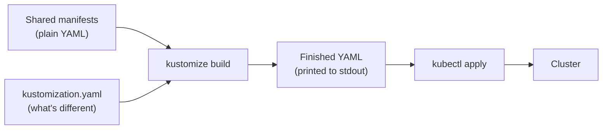

# Kustomize Basics

Working through each piece of Kustomize in order, starting from nothing.

Covers: why it exists, how it compares to Helm, installing it, the `kustomization.yaml` file, `resources`, `apiVersion` and `kind`, building and applying output, organising directories, and transformers.

Not covered here, these come later: patches, overlays, generators, garbage collection.

---

## Key terms

| Term | Definition |
|------|------------|
| **Manifest** | A single YAML file describing one Kubernetes object: a Deployment, a Service, a ConfigMap. |
| **Kustomize** | A tool that reads Kubernetes YAML, applies a set of described changes, and prints new YAML. It does not talk to the cluster. |
| **`kustomization.yaml`** | The control file. Kustomize looks for this exact filename in a directory. It lists which manifests to include and which changes to make. |
| **Base** | A directory of manifests holding the shared default configuration, the parts identical across all environments. |
| **Overlay** | A directory that points at a base and describes what's different for one environment. |
| **Transformer** | A built-in change applied across all resources at once, for example "add this namespace to everything". |
| **Patch** | A targeted change to one field of one resource, for example "set `replicas` to 10 on the Deployment named `web`". Covered next lesson. |
| **`kustomize build`** | The command that produces the finished YAML and prints it. It does not touch the cluster. |
| **Helm** | A Kubernetes package manager. Solves overlapping problems with a different approach. Compared below. |

---

## 1. Why Kustomize

You've got an NGINX deployment that needs to run in dev, staging and production. Most of the YAML is identical in all three. What differs is minor: replica count, image tag, maybe a couple of labels production needs and nowhere else does.

The obvious thing to do is make three folders, copy the YAML into each, and hard-code the differences. That's fine on a single deployment, but it doesn't hold up.

Every change now has to be made three times. Bump an image tag for a CVE and that's three files to edit. The day someone does two of them and gets pulled onto something else, dev and staging are patched and production isn't, and nothing looks obviously wrong because all three files still read about right.

Then the app grows. It isn't one Deployment any more, it's a Deployment, a Service, a ConfigMap and an Ingress, across three directories. That's twelve files to keep aligned by hand, and it's only a matter of time before one of them drifts.

### What the duplication looks like

```
k8s/
├── dev/
│   └── deployment.yaml
├── stage/
│   └── deployment.yaml
└── prod/
    └── deployment.yaml
```

The three files, side by side:

<table>
<tr>
<th><code>k8s/dev/deployment.yaml</code></th>
<th><code>k8s/stage/deployment.yaml</code></th>
<th><code>k8s/prod/deployment.yaml</code></th>
</tr>
<tr>
<td valign="top">

```yaml
apiVersion: apps/v1
kind: Deployment
metadata:
  name: web
  labels:
    app: web
    environment: dev

spec:
  replicas: 1
  selector:
    matchLabels:
      app: web
  template:
    metadata:
      labels:
        app: web
    spec:
      containers:
      - name: nginx
        image: nginx:1.27
        ports:
        - containerPort: 80
        resources:
          requests:
            cpu: 100m
            memory: 128Mi
```

</td>
<td valign="top">

```yaml
apiVersion: apps/v1
kind: Deployment
metadata:
  name: web
  labels:
    app: web
    environment: stage

spec:
  replicas: 2
  selector:
    matchLabels:
      app: web
  template:
    metadata:
      labels:
        app: web
    spec:
      containers:
      - name: nginx
        image: nginx:1.27.2
        ports:
        - containerPort: 80
        resources:
          requests:
            cpu: 100m
            memory: 128Mi
```

</td>
<td valign="top">

```yaml
apiVersion: apps/v1
kind: Deployment
metadata:
  name: web
  labels:
    app: web
    environment: prod
    cost-centre: platform
spec:
  replicas: 10
  selector:
    matchLabels:
      app: web
  template:
    metadata:
      labels:
        app: web
    spec:
      containers:
      - name: nginx
        image: nginx:1.27.2
        ports:
        - containerPort: 80
        resources:
          requests:
            cpu: 500m
            memory: 512Mi
```

</td>
</tr>
</table>

Read across any row and most of them are three identical lines.

### What actually differs

Three files, around 30 lines each, and this is everything that isn't the same:

| Field | dev | stage | prod |
|---|---|---|---|
| `metadata.labels.environment` | `dev` | `stage` | `prod` |
| `metadata.labels.cost-centre` | absent | absent | `platform` |
| `spec.replicas` | `1` | `2` | `10` |
| `image` | `nginx:1.27` | `nginx:1.27.2` | `nginx:1.27.2` |
| `resources.requests.cpu` | `100m` | `100m` | `500m` |
| `resources.requests.memory` | `128Mi` | `128Mi` | `512Mi` |

Confirm it yourself:

```bash
diff k8s/dev/deployment.yaml k8s/prod/deployment.yaml
```

What it does: prints the lines that differ between the two files.
Expected output: a handful of changed lines covering the environment label, the extra `cost-centre` label, the replica count, the image tag and the two resource values. Six values differ, and everything else is identical.

Add a Service, a ConfigMap and an Ingress and it's twelve files holding maybe a dozen genuinely different values between them.

Kustomize exists so you can keep one copy of the YAML and describe the changes instead of duplicating the file.

### What Kustomize is

Kustomize is an open-source tool for customising Kubernetes YAML without templates. It's an official Kubernetes project, and it ships inside `kubectl`, so anyone with `kubectl` installed already has it (`kubectl apply -k`).

The idea in one sentence: **keep plain, valid manifests in one place, and write down only what's different for each environment.** Kustomize combines the two and prints the result.

Applied to the NGINX example above:

- The ~30-line Deployment is written **once**, as a normal manifest you could `kubectl apply` on its own.
- Each environment gets a short `kustomization.yaml` holding only its differences: "replicas is 10", "image tag is `1.27.2`", "add the `cost-centre` label".
- Kustomize reads the shared manifest, applies one environment's changes, and outputs the finished YAML for that environment.



Three things to know about it from the start:

- **No templates.** The input files are real Kubernetes YAML, with no `{{ }}` placeholders. You can read, lint and apply them without Kustomize. Section 2 compares this with Helm's approach.
- **It runs before the cluster, not in it.** Kustomize reads YAML files and writes YAML to stdout. By the time `kubectl` sends anything to the API server, Kustomize has already finished and exited, so the cluster just sees ordinary manifests. There's nothing to install on the cluster and nothing running there afterwards.
- **It's declarative.** You describe the end state ("prod has 10 replicas"), not the steps to get there. With the same Kustomize version, the same input always produces the same output, which makes builds easy to diff and review.

The rest of this session builds that up one piece at a time: the `kustomization.yaml` file (section 4) and changes applied to everything at once (transformers, section 7). Changes to one specific resource (patches) are next lesson.

---

## 2. Kustomize vs Helm

Both tools exist because people got tired of copy-pasting YAML.

**Helm** uses Go templates. You write a manifest with placeholders and supply a `values.yaml` with the actual values:

```yaml
# A Helm template. Note this is not valid YAML on its own.
spec:
  replicas: {{ .Values.replicaCount }}
```

Helm gives you variables, conditionals, loops, functions and lifecycle hooks. The cost is that a Helm template isn't valid YAML until it's rendered, so your editor can't check it, and a complex chart gets hard to read.

**Kustomize** doesn't template anything. Every file in a Kustomize tree is valid, apply-able Kubernetes YAML from start to finish. There are no variables. Instead of "fill in this blank", you say "take this finished manifest and change this field".

| | Kustomize | Helm |
|---|---|---|
| Approach | Patch finished YAML | Render templates with variables |
| Files are valid YAML | Yes, always | No, not until rendered |
| Learning curve | Lower | Higher |
| Logic (if/loops/functions) | No | Yes |
| Packaging and distribution | No | Yes, it's a package manager |
| Release tracking and rollback | No | Yes (`helm rollback`) |
| Needs installing | No, built into `kubectl` | Yes |

Helm is a package manager and does much more than customisation, including versioning, distributing and rolling back releases. Kustomize does one job and is easier to read. They aren't mutually exclusive, and it's common to see Helm used for third-party software and Kustomize for in-house applications.

---

## 3. Installing it and checking the version

There are two separate Kustomizes on most machines, and this matters later.

**The standalone binary.** Installed from the upstream project's install script or a package manager.

```bash
kustomize version
```

What it does: prints the standalone Kustomize version.
Good output: something like `v5.4.3`.
Bad output: `command not found`, meaning the standalone binary isn't installed. Use the `kubectl` route below instead.

> In Kustomize v4 the usual invocation was `kustomize version --short`. The `--short` flag was removed in v5, where plain `kustomize version` already prints the short form. A runbook that still uses `--short` and errors is a v4-era runbook running on v5.

**The copy inside `kubectl`.** Kustomize is vendored into `kubectl`, so it's already there.

```bash
kubectl version --client
```

What it does: shows the `kubectl` version, which determines the embedded Kustomize version.
Good output: a client version line, for example `Client Version: v1.30.4`.

The embedded copy often lags behind the standalone binary. The two can produce different results from identical input, which is worth knowing before anyone spends an afternoon on it.

---

## 4. kustomization.yaml

This is the only file Kustomize genuinely needs. You point Kustomize at a **directory**, not a file, and it looks inside for a file named exactly `kustomization.yaml`.

Accepted filenames are `kustomization.yaml`, `kustomization.yml` and `Kustomization`. Anything else is not found.

A minimal one:

```yaml
apiVersion: kustomize.config.k8s.io/v1beta1
kind: Kustomization

resources:
  - deployment.yaml
```

That's it. Two lines of header, and a list of the manifests to manage.

### apiVersion and kind

```yaml
apiVersion: kustomize.config.k8s.io/v1beta1
kind: Kustomization
```

Kustomize will run without these and assume them. Write them anyway. They're the version marker that protects the file when Kustomize introduces breaking changes, and they make it self-describing to anyone reading it cold.

The same logic applies to the Kubernetes manifests themselves. Pin a real `apiVersion` rather than relying on defaults.

### resources

`resources:` is the list of manifests Kustomize will manage.

```yaml
resources:
  - deployment.yaml
  - service.yaml
  - configmap.yaml
```

If a file isn't in this list, Kustomize ignores it, even when it's sitting in the same directory. Adding `ingress.yaml` to the folder does nothing on its own; it has to be listed here.

An entry in `resources:` can also be another **directory** containing its own `kustomization.yaml`. That's covered in section 6.

### Try it

The worked example lives in `Kustomize/1_basics/`. It's a small app (MongoDB, RabbitMQ and nginx) split into one folder per component:

```
Kustomize/1_basics/
├── kustomization.yaml
├── db/
│   ├── db-config.yaml
│   ├── db-depl.yaml
│   └── db-service.yaml
├── message-broker/
│   ├── rabbitmq-config.yaml
│   ├── rabbitmq-depl.yaml
│   └── rabbitmq-service.yaml
└── nginx/
    ├── nginx-depl.yaml
    └── nginx-service.yaml
```

The manifests are ordinary Kubernetes YAML. For example, `Kustomize/1_basics/nginx/nginx-depl.yaml`:

```yaml
apiVersion: apps/v1
kind: Deployment
metadata:
  name: kustomize-nginx-deployment
spec:
  replicas: 3
  selector:
    matchLabels:
      component: kustomize-nginx
  template:
    metadata:
      labels:
        component: kustomize-nginx
    spec:
      containers:
        - name: nginx
          image: nginx
```

There's one `kustomization.yaml` at the top, and it lists every file by path.

`Kustomize/1_basics/kustomization.yaml`:

```yaml
apiVersion: kustomize.config.k8s.io/v1beta1
kind: Kustomization

resources:
  - db/db-config.yaml
  - db/db-depl.yaml
  - db/db-service.yaml
  - message-broker/rabbitmq-config.yaml
  - message-broker/rabbitmq-depl.yaml
  - message-broker/rabbitmq-service.yaml
  - nginx/nginx-depl.yaml
  - nginx/nginx-service.yaml
```

Kustomize doesn't change anything here. It just collects the eight files. Section 6 covers a tidier way to organise them.

---

## 5. Building and applying the output

### kustomize build

```bash
kustomize build Kustomize/1_basics
```

What it does: reads the directory and prints the finished YAML to stdout.
Good output: all 8 objects (2 ConfigMaps, 3 Services, 3 Deployments) in one stream, separated by `---`. Nothing modifies them yet, so their content is passed through unchanged. Kustomize does reorder them by kind and sort their fields alphabetically, so the output won't look exactly like the source files.
Bad output: `unable to find one of 'kustomization.yaml', ...` means the path is wrong or the filename is misspelled.

**`build` does not deploy anything.** It prints. It doesn't contact the cluster, doesn't need a kubeconfig, and changes nothing. Running it and seeing a wall of YAML scroll past is not a deployment.

Because it needs no cluster, the output is also a safe thing to generate and share when diagnosing a problem.

The `kubectl` equivalent:

```bash
kubectl kustomize Kustomize/1_basics
```

Same output, using the embedded copy. Note the subcommand is `kubectl kustomize`, not `kubectl apply -k`. This one only prints. A connection-refused error here means `apply -k` was typed by mistake.

### Redirecting the output

Since `build` writes to stdout, the output goes wherever you send it.

```bash
kustomize build Kustomize/1_basics > rendered.yaml
```

Writes the finished YAML to a file for inspection or review.

### Applying it

Two equivalent ways.

```bash
kustomize build Kustomize/1_basics | kubectl apply -f -
```

What it does: builds the YAML and pipes it into `kubectl`. The `-f -` means "read from stdin".
Good output: one `created` line per object, 8 in total:

```
configmap/kustomize-db-credentials created
configmap/kustomize-rabbitmq-credentials created
service/kustomize-db-service created
service/kustomize-nginx-service created
service/kustomize-rabbitmq-service created
deployment.apps/kustomize-db-deployment created
deployment.apps/kustomize-nginx-deployment created
deployment.apps/kustomize-rabbitmq-deployment created
```

```bash
kubectl apply -k Kustomize/1_basics
```

What it does: the same thing in one step. `-k` tells `kubectl` to run Kustomize on that directory and apply the result.
Good output: the same 8 lines. If you already applied it with the piped form, they say `unchanged` instead of `created`.

Use the piped form when you want to look at the YAML first. Use `-k` when you don't.

### Deleting it

> Destructive, lab or test environment only. `kubectl delete` removes live workloads. Never run a delete against a production system without explicit written confirmation of the exact scope.

```bash
kubectl delete -k Kustomize/1_basics
```

What it does: builds the same YAML and deletes exactly those objects.
Good output: 8 `deleted` lines, for example `deployment.apps "kustomize-nginx-deployment" deleted`.

```bash
kustomize build Kustomize/1_basics | kubectl delete -f -
```

The piped equivalent. Both are safer than a loose `kubectl delete`, because the scope is defined by the same files that created it.

---

## 6. Organising directories as things grow

A single `kustomization.yaml` listing forty manifests becomes its own problem. The fix is nesting. Give each component its own directory and its own `kustomization.yaml`, then have the parent reference the directories.

```
k8s/
├── kustomization.yaml          # resources: [ api/, db/ ]
├── api/
│   ├── kustomization.yaml      # resources: [ deployment.yaml, service.yaml ]
│   ├── deployment.yaml
│   └── service.yaml
└── db/
    ├── kustomization.yaml
    ├── statefulset.yaml
    └── service.yaml
```

The parent:

```yaml
apiVersion: kustomize.config.k8s.io/v1beta1
kind: Kustomization

resources:
  - api
  - db
```

Two valid styles, and both turn up in the wild:

**Flat file list.** The parent `kustomization.yaml` lists every file path directly:

```yaml
resources:
  - api/deployment.yaml
  - api/service.yaml
  - db/statefulset.yaml
  - db/service.yaml
```

Simpler, fine for small projects, grows to hundreds of lines.

**Nested kustomizations.** Each subdirectory owns its own list and the parent references only directories. More files, but each stays short, and any subdirectory can be built and tested on its own:

```bash
kustomize build k8s/api
```

Each nested `kustomization.yaml` can also carry its own transformers (and, from next lesson, patches), applying to that subtree only. Useful, and also the usual answer to "where is that change coming from?" Check one level down.

---

## 7. Transformers

A transformer is a change applied to **every** resource in the `kustomization.yaml` at once. A patch, covered next lesson, edits one field of one resource. A transformer edits the same field everywhere.

Typical reasons to reach for one:

- Every object needs a team or project label so it can be found and cleaned up later.
- Several people deploy the same manifests into a shared cluster and the names collide.
- Everything needs to land in one namespace.

The manual alternative is to edit every file by hand. With eight manifests that's eight edits, plus every place one object refers to another by name, plus every selector. Miss one and a Service quietly stops finding its pods. Transformers do it in one place and keep the references consistent.

The worked example lives in `Kustomize/3_transformers/`. Its manifests use plain names (`db-deployment`, `nginx-service`, `component: db`) and the `kustomization.yaml` files add everything else.

### namePrefix

```yaml
namePrefix: kustomize-
```

What it does: puts `kustomize-` in front of `metadata.name` on every resource. `db-deployment` becomes `kustomize-db-deployment`, `db-credentials` becomes `kustomize-db-credentials`, and so on.

The part that makes this better than search-and-replace is that Kustomize also updates **references** to those names. The db Deployment reads its env vars from the ConfigMap by name:

```yaml
configMapKeyRef:
  name: db-credentials
  key: username
```

After the prefix is applied the output reads `name: kustomize-db-credentials`, so the reference still points at the renamed ConfigMap. Rename the ConfigMap by hand and forget the reference, and the pod sits in `CreateContainerConfigError`.

`nameSuffix` works the same way on the end of the name, for example `nameSuffix: -v1`.

Prefixes and suffixes change **names**, not labels.

### Common labels

```yaml
labels:
  - pairs:
      app.kubernetes.io/part-of: kustomize-lesson
      owner: platform-team
    includeSelectors: true
```

What it does: adds both labels to `metadata.labels` on every resource. With `includeSelectors: true` it also adds them to every Deployment's `spec.selector.matchLabels`, every pod template's labels and every Service's `spec.selector`.

That second half matters. A Service's selector and its pods' labels have to match exactly. Adding a label to the selector but not to the pods, or the other way round, leaves the Service with no endpoints. With `includeSelectors: true`, Kustomize updates both sides together.

With `includeSelectors: false` (the default), the labels go on `metadata.labels` only. Selectors and pod templates are left alone. Use that for purely informational labels such as a cost centre, where you don't want to change what a Service selects.

There's a middle option, `includeTemplates: true`. The labels go on `metadata.labels` and on the pod template, but not on selectors. Use it when you want to filter pods by a label (`kubectl get pods -l ...`) without changing what a Service or Deployment selects.

| Setting | `metadata.labels` | Pod template labels | Selectors |
|---|---|---|---|
| default (neither set) | Yes | No | No |
| `includeTemplates: true` | Yes | Yes | No |
| `includeSelectors: true` | Yes | Yes | Yes |

> **Selectors are immutable on a Deployment.** Adding `includeSelectors: true` to something already running in a cluster changes `spec.selector`, and `kubectl apply` will reject it with a `field is immutable` error. Decide on selector labels before the first deploy, or delete and recreate in a lab.

> Older configs use `commonLabels:` instead. It behaves like `labels:` with `includeSelectors: true`. On Kustomize v5 it still works but prints `Warning: 'commonLabels' is deprecated. Please use 'labels' instead.` Running `kustomize edit fix` in the directory converts it.

### The full example

`Kustomize/3_transformers/` uses the nested layout from section 6. Every directory has its own `kustomization.yaml`, and every one of them carries transformers.

```
Kustomize/3_transformers/
├── kustomization.yaml          # namePrefix: kustomize-, team-wide labels, nginx image tag
├── db/
│   └── kustomization.yaml      # nameSuffix: -v1, tier: database
├── message-broker/
│   └── kustomization.yaml      # namePrefix: mq-, tier: messaging, broker: rabbitmq
└── nginx/
    └── kustomization.yaml      # nameSuffix: -web, tier: frontend, exposure: nodeport
```

The parent sets what applies to everything:

`Kustomize/3_transformers/kustomization.yaml`:

```yaml
apiVersion: kustomize.config.k8s.io/v1beta1
kind: Kustomization

# Transformers: applied to every resource from every subdirectory below,
# after each subdirectory has applied its own.
namePrefix: kustomize-

labels:
  - pairs:
      app.kubernetes.io/part-of: kustomize-lesson
      owner: platform-team
    includeSelectors: true

images:
  - name: nginx
    newTag: "1.27.2"

resources:
  - db/
  - message-broker/
  - nginx/
```

Each subdirectory adds its own, and they apply to that subdirectory only:

`Kustomize/3_transformers/db/kustomization.yaml`:

```yaml
apiVersion: kustomize.config.k8s.io/v1beta1
kind: Kustomization

# Suffix only the db objects: db-deployment -> db-deployment-v1
nameSuffix: -v1

# Selector label: added to metadata, pod template and selectors.
labels:
  - pairs:
      tier: database
    includeSelectors: true

resources:
  - db-config.yaml
  - db-depl.yaml
  - db-service.yaml
```

`Kustomize/3_transformers/message-broker/kustomization.yaml`:

```yaml
apiVersion: kustomize.config.k8s.io/v1beta1
kind: Kustomization

# Prefix only the message-broker objects: rabbitmq-deployment -> mq-rabbitmq-deployment
namePrefix: mq-

labels:
  # Selector label: added to metadata, pod template and selectors.
  - pairs:
      tier: messaging
    includeSelectors: true
  # Informational label: metadata only, selectors untouched.
  - pairs:
      broker: rabbitmq

resources:
  - rabbitmq-config.yaml
  - rabbitmq-depl.yaml
  - rabbitmq-service.yaml
```

`Kustomize/3_transformers/nginx/kustomization.yaml`:

```yaml
apiVersion: kustomize.config.k8s.io/v1beta1
kind: Kustomization

# Suffix only the nginx objects: nginx-service -> nginx-service-web
nameSuffix: -web

labels:
  # Selector label: added to metadata, pod template and selectors.
  - pairs:
      tier: frontend
    includeSelectors: true
  # Pod label: added to metadata and the pod template, but not selectors.
  - pairs:
      exposure: nodeport
    includeTemplates: true

resources:
  - nginx-depl.yaml
  - nginx-service.yaml
```

Transformers stack from the inside out. Each subdirectory is built first, then the parent's transformers run over the result. So a name picks up the subdirectory's prefix or suffix, then the parent's prefix:

| Original name | After subdirectory | After parent |
|---|---|---|
| `db-deployment` | `db-deployment-v1` | `kustomize-db-deployment-v1` |
| `db-credentials` | `db-credentials-v1` | `kustomize-db-credentials-v1` |
| `rabbitmq-deployment` | `mq-rabbitmq-deployment` | `kustomize-mq-rabbitmq-deployment` |
| `rabbitmq-credentials` | `mq-rabbitmq-credentials` | `kustomize-mq-rabbitmq-credentials` |
| `nginx-deployment` | `nginx-deployment-web` | `kustomize-nginx-deployment-web` |

The ConfigMap references in the db and RabbitMQ Deployments are updated at both levels, so they still point at the right ConfigMap.

Build one subdirectory on its own to see only its transformers:

```bash
kustomize build Kustomize/3_transformers/db
```

Good output: names end in `-v1` and carry `tier: database`, with no `kustomize-` prefix and no team labels yet. Those come from the parent.

Then build the whole thing:

```bash
kustomize build Kustomize/3_transformers
```

Good output:
- Every name starts with `kustomize-`, and every object has `app.kubernetes.io/part-of` and `owner`.
- Each object also has its own `tier` label, which appears in its Service's `selector`.
- `broker: rabbitmq` appears in RabbitMQ's `metadata.labels` only, not in its pod template or selector.
- `exposure: nodeport` appears in nginx's `metadata.labels` and pod template, not in its selector.
- The nginx container image is `nginx:1.27.2`, set by the `images` transformer.

Bad output: a warning about `commonLabels`, which means you're looking at an older copy of the file.

Compare it with `Kustomize/1_basics/`. That folder holds the same app with `kustomize-` typed into every name, label and reference by hand. Here the manifests stay plain and every naming decision is one line in a `kustomization.yaml`.

Apply it and check the Services found their pods:

```bash
kubectl apply -k Kustomize/3_transformers
kubectl get pods -l app.kubernetes.io/part-of=kustomize-lesson -L tier
kubectl get endpoints -l app.kubernetes.io/part-of=kustomize-lesson
```

Good output: 5 pods `Running`, with a `TIER` column showing `database`, `messaging` or `frontend`. Each of the three Services lists at least one pod IP.
Bad output: `<none>` under endpoints, which means a selector and the pod labels don't match.

The labels also let you narrow down what you're looking at. `kubectl get pods -l tier=frontend` shows only nginx, and `kubectl get pods -l exposure=nodeport` works because that label was added to the pod template.

### Other common transformers

All of these sit at the top level of `kustomization.yaml` and apply to every resource in it.

| Field | What it does | Example |
|---|---|---|
| `namespace` | Sets `metadata.namespace` on every resource | `namespace: lesson` |
| `nameSuffix` | Appends to every name, references updated | `nameSuffix: -v1` |
| `commonAnnotations` | Adds annotations to every resource and pod template | `commonAnnotations: { contact: platform-team }` |
| `images` | Changes an image name or tag wherever that image is used | see below |

```yaml
images:
  - name: nginx
    newTag: "1.27.2"
```

What it does: finds every container using the `nginx` image and sets the tag to `1.27.2`. It does the job of an image patch (next lesson) without needing to know the container's index or name.

Transformers and patches can be used in the same `kustomization.yaml`. The usual split is transformers for anything that applies everywhere, and patches for changes to one specific resource. Patches are the subject of the next lesson.

---

## 8. Common errors

| Message or symptom | Cause | Check |
|---|---|---|
| `unable to find one of 'kustomization.yaml'...` | Wrong directory, or the file is misnamed | `ls <dir>` |
| A manifest is missing from the output | It isn't listed under `resources:` | The `resources:` list |
| `json: unknown field "<x>"` | The field is newer than the Kustomize running it | `kustomize version` and `kubectl version --client` |
| Connection refused from `kubectl kustomize` | `apply -k` typed instead of `kustomize` | The subcommand |
| Nothing deployed after running `build` | `build` only prints | Pipe to `kubectl apply -f -`, or use `apply -k` |
| Deprecation warning on `commonLabels` | Config written for v4, running on v5 | Switch to `labels:` with `includeSelectors: true`, or run `kustomize edit fix` |
| Service has no endpoints after adding labels | Labels added to the selector but not to the pods, or the reverse | Use `labels:` with `includeSelectors: true` so both sides change together |
| `field is immutable` on apply | A transformer changed `spec.selector` on a Deployment that already exists | Delete and recreate it (lab only), or don't change selector labels after the first deploy |
| `CreateContainerConfigError` after renaming | A ConfigMap or Secret was renamed by hand and a reference to it wasn't | Use `namePrefix`/`nameSuffix`, which update references for you |

---

## 9. What's next

The pieces above cover a single directory of manifests, with transformers applied to them. The next layer up:

- **Patches** (next lesson): targeted changes to one field of one resource. Strategic merge and JSON 6902 formats, renaming a resource, targeting several resources at once, and inline vs separate patch files. The worked example is `Kustomize/4_patches/`, which applies seven patches to the app from this lesson.
- **Overlays**: the base and overlay directory pattern. This is the piece that finishes the section 1 example, collapsing the three duplicated `deployment.yaml` files into one shared copy plus three short files holding only the six values that differ.
- **Generators**: `configMapGenerator` and `secretGenerator`, building ConfigMaps and Secrets from literals or files, and the name-hash behaviour that rolls pods automatically.
- **Garbage collection**: what happens to objects that are no longer in the output, and how pruning works.

---

## Reference

- Declarative Management of Kubernetes Objects Using Kustomize: https://kubernetes.io/docs/tasks/manage-kubernetes-objects/kustomization/
- Kustomize official site: https://kustomize.io/
- `kustomization.yaml` field reference: https://kubectl.docs.kubernetes.io/references/kustomize/kustomization/
- `kubectl apply` reference: https://kubernetes.io/docs/reference/generated/kubectl/kubectl-commands#apply
